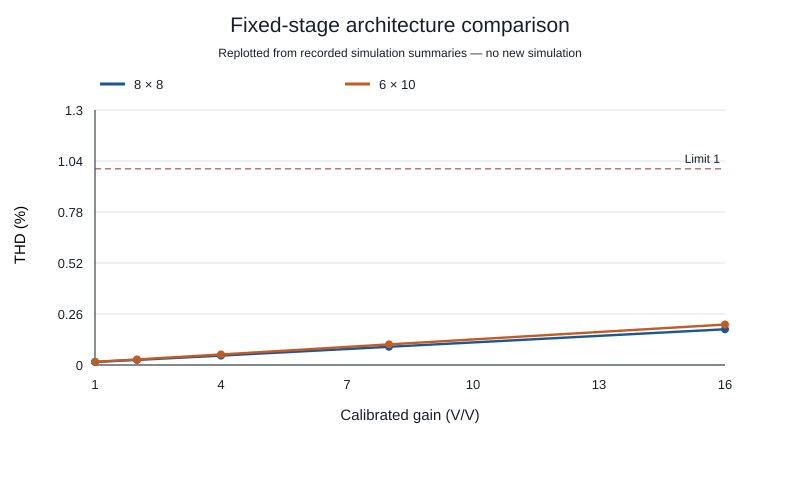
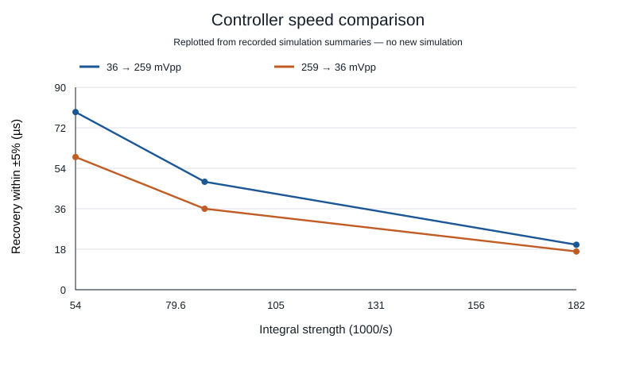
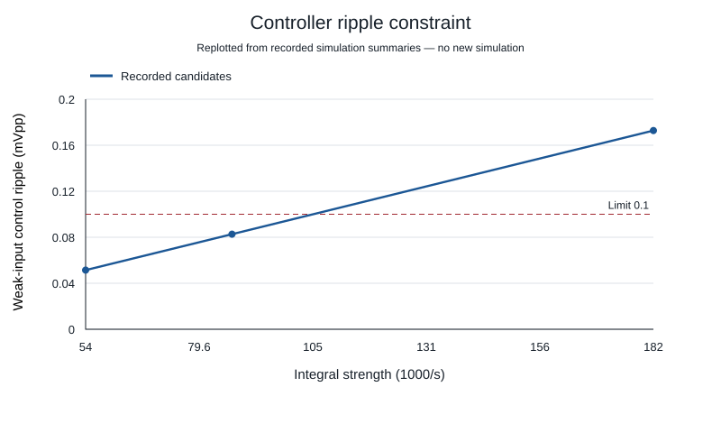

# CMOS Variable-Gain Amplifier with Behavioural Automatic Gain Control

A transistor-level simulation of a CMOS variable-gain amplifier (VGA) with behavioural automatic gain control (AGC), including its coupling to a photodiode TIA.

The repository bundles the TIA model and settings. The circuit simulations use generic Level-1 MOS parameters.

## Circuit and experiment

The 22-MOS analogue signal path combines a complementary-MOS input attenuator with two fixed-gain amplifier stages. Envelope detection, complementary control generation and bounded integral control are behavioural blocks. A 1.8 V supply, 1 pF output load and 1 MHz carrier were used. Nominal fixed-stage gains of 8 × 8 and 6 × 10 were compared after independent calibration to overall gains of 1, 2, 4, 8 and 16 V/V.

The fixed experiment and pass criteria are in `protocol.json`. Candidates must meet all five fixed-gain tests: THD ≤1%, absolute gain deviation ≤1%, bandwidth ≥5 MHz and peaking ≤0.5 dB. The controller selection then requires steady amplitude error ≤5% at five input amplitudes and weak-signal control ripple ≤0.10 mVpp; recovery speed is optimised only among candidates meeting those limits. Rejected candidates and temperature-test failures remain in the tables.

## Recorded results

| Quantity | Recorded result | Conditions and scope |
|---|---|---|
| Selected fixed-stage gains | 8 × 8 | Overall calibrated gain 1–16 V/V at 1 MHz |
| Analogue core DC power | 1.242 mW | 1.8 V; excludes physical implementation of behavioural control and reference generation |
| Input-referred noise ASD | 34.11 nV/√Hz | 100 kHz, fixed gain 16; generic model, not integrated/system noise |
| Selected integral strength | 87,000 s⁻¹ | Weak-signal control ripple about 0.0827 mVpp |
| Recovery times | 48 / 36 µs | 36→259 / 259→36 mVpp input at 1 MHz; output returns to and remains within ±5% |
| Faster rejected controller | 20 / 17 µs; 0.173 mVpp ripple | 182,000 s⁻¹ fails the 0.10 mVpp weak-signal ripple constraint |
| TIA–VGA cascade output | Approximately 350 mVpp | Three tested detector currents: 0.443, 1.279 and 3.185 µApp |
| Cascade bandwidth | 7.155–7.159 MHz | Small-signal AC at fixed VGA gains 1, 4 and 16; not an AGC-loop bandwidth |
| Temperature sensitivity | 1.94% THD at 70 °C | 100 mVpp input; amplitude remains within ±5%, but distortion fails the 1% criterion |

Values above are rounded from preserved `vga/results` tables. Power is calculated from simulated supply current. Input reconstruction is a calculation from simulated steady-state fundamental amplitude and an independent gain calibration; constant regulated output alone does not recover the original signal amplitude. The upward input step briefly overloads the signal path; fast steady-state regulation is not proof of overload-free operation.







## Files

- `vga/models/`: generic MOS/VGA model and complete seven-MOS TIA core.
- `vga/study.py`: fixed-gain architecture, AGC, operating point, noise, numerical refinement and actual TIA–VGA cascade simulations.
- `vga/helpers/`: LTspice deck generation and ASCII waveform analysis.
- `vga/runs/*/test.cir`: generated netlists with repository-local includes.
- `vga/results/`: compact original summary tables, calibrations, selected and rejected candidate data.
- `tia/selection.json`: numerical TIA settings and original model hash, required by cascade tests.
- `plot_summary_svg.py`: regenerate the included SVG figures with Python's standard library only. `plot_results.py` creates additional Matplotlib PNG/SVG plots when its dependencies are installed.
- `check_package.py`: local dependencies, model hash, deck includes and result sanity checks.
- `evidence/`: data sources, omitted files and simulation run metadata.

The figures use the saved summary tables. The [verification record](evidence/package_checks.json) covers a representative LTspice AC sweep at five gains near 1 MHz, dependency imports and generated cascade-deck equivalence.

## Requirements

First, run the offline checks with Python 3.12; no simulator or third-party package is needed:

```bash
python3 check_package.py
python3 plot_summary_svg.py
```

The original study used LTspice 26.0.2 on macOS. Install LTspice separately; no simulator binary is redistributed. Python 3.12 and the versions in `requirements.txt` match the recorded environment. The driver uses `fcntl` locking and the Mac LTspice batch launcher.

```bash
python3 -m venv .venv
source .venv/bin/activate
python -m pip install -r requirements.txt
python check_package.py
python check_package.py --generated-deck
python plot_results.py
```

## Reproduce the SPICE study

`study.py` writes results in place. Run it in a separate copy to preserve the reference tables. With no raw outputs supplied, the first run executes the simulations; subsequent successful unchanged decks may be reused by input/model hash.

The default launcher is `/Applications/LTspice.app/Contents/SharedSupport/ltspice/LTspice/run_ltspice`. If the simulator is elsewhere, set `LTSPICE_RUNNER` to a compatible executable supporting `-b -ascii`.

For a quick real-simulator check, `python smoke_test.py` runs one original fixed-gain AC sweep in a new temporary folder and verifies its five gains near 1 MHz. It does not alter the reference tables. Its output reports the temporary folder and whether execution succeeded.

```bash
python vga/study.py --stage all
python vga/check_rejected.py
python vga/verify_existing_claims.py
python plot_results.py
python check_package.py
```

To run just one part, use `--stage architecture`, `controller`, `validation` or `cascade`. Later stages read earlier-stage selections, which are included with this repository. `check_rejected.py` repeats the narrowly failing architecture with a smaller time step. `verify_existing_claims.py` repeats the bounded high-gain input grid and 0/70 °C sensitivity checks without retuning.

## Measurement definitions and limitations

THD uses harmonics 2–10 of the last 20 complete cycles after uniform resampling. Recovery is cycle-resolved: the first carrier-cycle end after which output peak-to-peak amplitude stays within ±5% through the observation window, with at least 20 further cycles. It is not a subcycle interpolated measurement. Core noise is fixed-control, DC-linearised `.noise` analysis; behavioural controller noise and power are excluded. Reported core power is time-weighted where obtained from transient data.

The cascade uses a 10 nF coupling capacitor and 1 MΩ bias resistor. No fabricated devices, layout, extracted parasitics, physical AGC implementation, foundry process corners or mismatch/yield results are claimed.

## Attribution and reuse

The [source manifest](evidence/package_provenance.json) records hashes for the original models, netlists and runs. LTspice is a separate Analog Devices tool.
